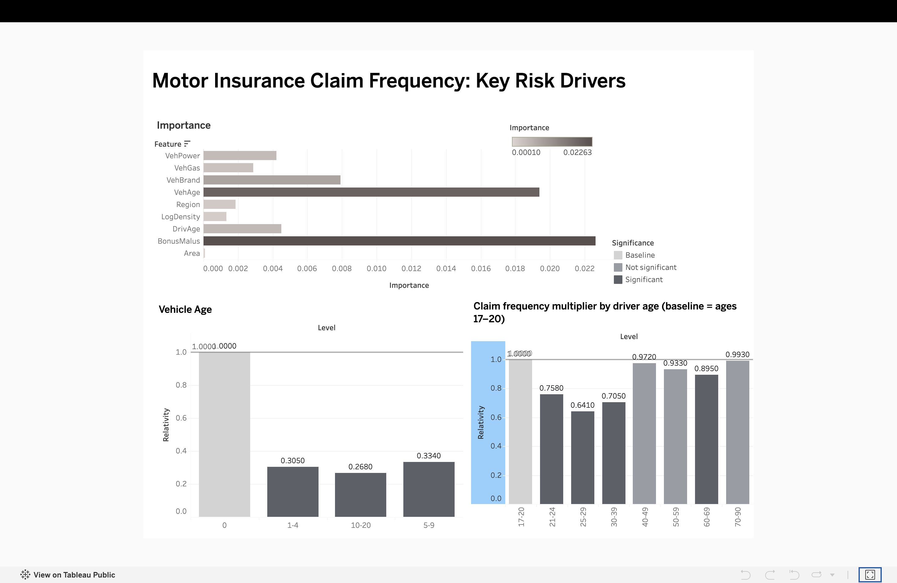
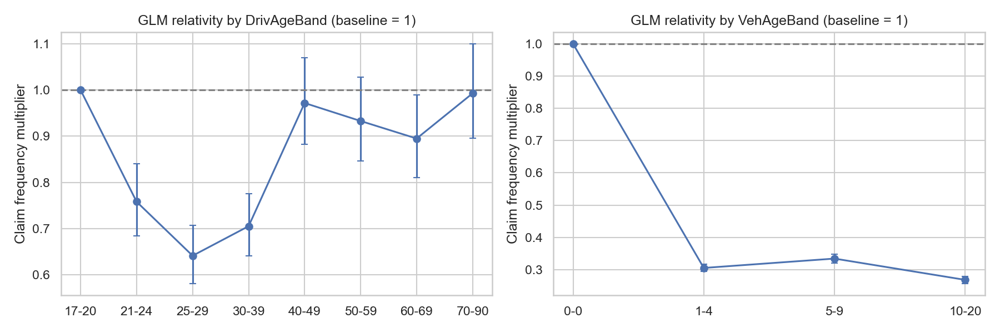
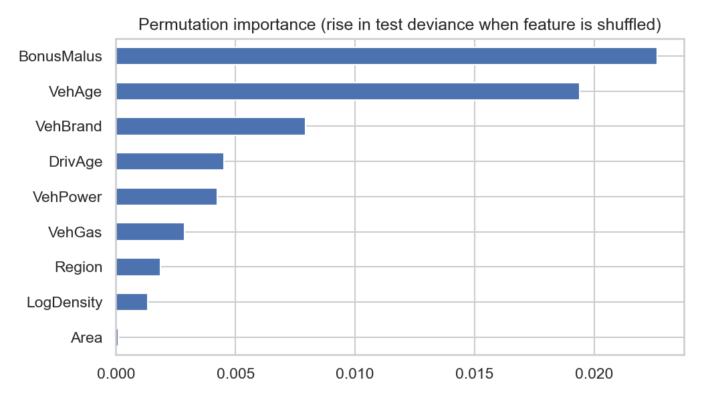

# Motor Insurance Claims Frequency Pricing Model

Predicting how often motor policyholders claim, using a **Poisson GLM** (the standard actuarial pricing model) and a **gradient boosting** benchmark, on 678,013 French motor third-party liability policies (freMTPL2freq).

**[Live Tableau dashboard](https://public.tableau.com/app/profile/arakya.kaushik/viz/MotorInsuranceClaimFrequency/Dashboard1)** | [Notebook](Motor_Insurance_Claims_Frequency.ipynb)



---

## Why this problem

Insurers set prices by estimating how likely each customer is to claim. The usual first step is **claim frequency**: the number of claims per year of cover. This project models it from driver, vehicle and location factors, then turns the model into multipliers (relativities) that a pricing or underwriting team can read directly.

## Key results

Test set: 135,603 policies (20% hold-out, `random_state=42`). The score is **mean Poisson deviance** (lower is better).

| Model | Test deviance | Improvement vs baseline |
|---|---|---|
| Baseline (same average rate for everyone) | 0.3312 | - |
| Poisson GLM | 0.3165 | 4.4% |
| Gradient boosting | 0.3055 | 7.8% |

* Both models beat the baseline on data they did not see, so the rating factors carry real signal.
* Gradient boosting is 3.5% better than the GLM, so there are non-linear effects or interactions that a log-linear model misses.
* The GLM's training deviance per row (0.313) is close to its test deviance (0.3165), so it is not overfitting.
* The GLM is the more transparent model, so its relativities feed the dashboard.

## What drives claim frequency

Overall frequency is **0.10 claims per policy-year** (36,102 claims over 358,499 policy-years).



GLM relativities (multiplier on claim frequency, other factors held equal):

| Factor | Finding |
|---|---|
| **Driver age** | Drivers aged 17-20 are the riskiest. Ages 21-24 are 0.76x, 25-29 are 0.64x and 30-39 are 0.71x of that baseline. Older bands are close to the baseline and mostly not statistically distinguishable from it. |
| **Vehicle age** | Cars aged 1-4 are about 0.31x the frequency of cars under 1 year, and older bands are similar (0.27x to 0.33x). |
| **BonusMalus (claims history)** | +2.3% claim frequency per point. A driver at 100 is roughly 3x as likely to claim as one at 50. |
| **Fuel** | Regular petrol is 1.05x diesel. |
| **Area** | No significant effect once population density and region are included. Raw frequency rises from 0.082 (Area A) to 0.139 (Area F), but Area overlaps with density and region. |

Gradient boosting relies mostly on the same signals:



Permutation importance ranks **BonusMalus** and **VehAge** far above the rest, then VehBrand, DrivAge and VehPower. Area contributes almost nothing.

## Method

1. **Data.** `fetch_openml(data_id=41214)` loads freMTPL2freq: 11 columns, no missing values.
2. **Checks and cleaning.**
   * 28,688 rows are identical in their features. Each is a different policy (different `IDpol`), so they were **kept**.
   * Capped extreme values: `ClaimNb` at 4, `Exposure` at 1 (1,224 policies exceeded one year), `VehAge` at 20, `DrivAge` at 90, `BonusMalus` at 150.
   * `Density` is heavily skewed (median 393, max 27,000), so the model uses `log(Density)`.
   * Driver age and vehicle age were grouped into bands for the GLM.
3. **Exploration.** Claim frequency by group is claims divided by exposure, not the average of per-row rates, so a 3-month policy is not weighed like a 12-month one.
4. **Split.** 80/20 train/test, fixed seed.
5. **Poisson GLM** (`statsmodels`). Log link, with `log(Exposure)` as an **offset** so a 6-month policy expects half the claims of a 12-month one.
6. **Gradient boosting** (`HistGradientBoostingRegressor`, Poisson loss). The target is frequency (claims / exposure) with exposure as the sample weight.
7. **Evaluation.** Mean Poisson deviance on the held-out test set.
8. **Interpretation.** GLM coefficients are turned into relativities with 95% confidence intervals (`exp(coef)`), and permutation importance is computed for the boosted model.
9. **Dashboard.** Relativities and importance exported to CSV and visualised in Tableau Public.

## Project structure

```
├── Motor_Insurance_Claims_Frequency.ipynb   # full analysis, run top to bottom
├── figures/                                 # charts used in this README
├── glm_relativities_tableau.csv             # GLM relativities (Tableau input)
├── gbm_importance.csv                       # permutation importance (Tableau input)
├── requirements.txt
└── README.md
```

## How to run

```bash
git clone https://github.com/arakya/Motor-Insurance-Claims-Frequency-GLM.git
cd Motor-Insurance-Claims-Frequency-GLM
python -m venv .venv && source .venv/bin/activate   # Windows: .venv\Scripts\activate
pip install -r requirements.txt
jupyter notebook Motor_Insurance_Claims_Frequency.ipynb
```

The dataset is downloaded from OpenML on the first run and cached locally. It is not stored in this repository.

If the download fails with `CERTIFICATE_VERIFY_FAILED` on macOS (python.org installs), run `/Applications/Python\ 3.12/Install\ Certificates.command` once and restart the notebook kernel.

## Limitations and next steps

* **Overdispersion.** Pearson chi-square divided by residual degrees of freedom is about 2.2, so real claim counts vary more than a pure Poisson allows. Standard errors and p-values are probably optimistic. A negative binomial or quasi-Poisson model would address this.
* **Frequency only.** There is no claim-severity model, so this is not yet a full pure premium.
* **Vehicle age under 1 year.** The very high frequency for this band (0.31 vs 0.08 to 0.10 for older cars) may partly reflect how first-year and short policies are recorded. Treat it as an association, not a cause.
* **Single split, untuned boosting.** Cross-validation and hyperparameter tuning would give a more reliable model ranking.
* **Judgment calls.** Caps and age bands were chosen by hand and could be tested for sensitivity.
* **Next steps:** negative binomial GLM, interaction terms (for example driver age x vehicle power) to close the gap with boosting, a severity model, and a lift chart.

## Data

freMTPL2freq (French motor third-party liability, 678,013 policies), available on [OpenML](https://www.openml.org/d/41214) and used in the scikit-learn documentation.

## Author

**Arakya Kaushik**, MSc Statistical Data Science, University College Dublin
[LinkedIn](https://www.linkedin.com/in/arakya-kaushik-5408a623a/) · [GitHub](https://github.com/arakya)
